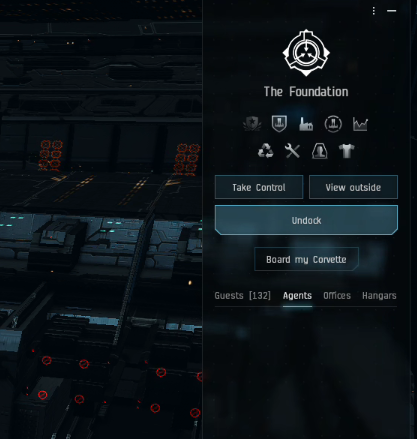
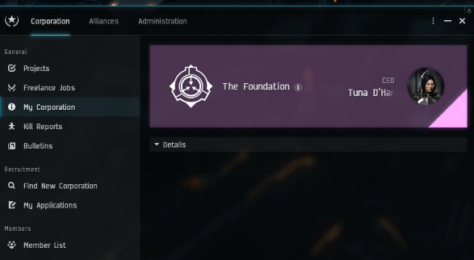
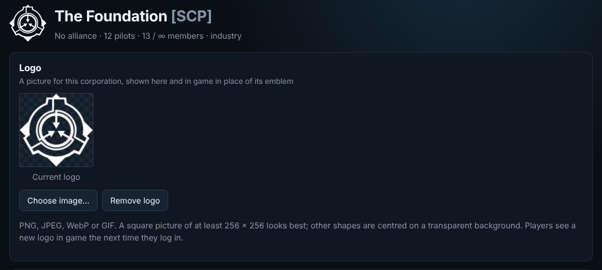
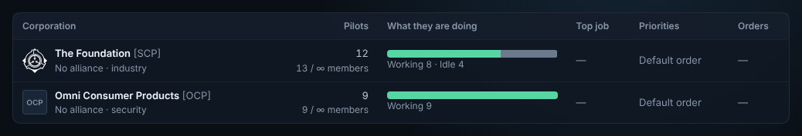

# Corporation Logos for EveJS

Give player and bot corporations their own PNG logo in game, the way
alliances already have one, instead of the three-layer emblem from the
emblem builder.

<p align="center">
  
  &nbsp;
  
</p>
<p align="center"><sub>In game: a corporation's PNG logo in a station's services panel and in the Corporation window (EveJS 261115.2, client 3396210).</sub></p>

- **Works in game** wherever the client draws a corporation logo: info
  windows, station services, the Corporation window, search, menus,
  banners, the character sheet, the job board, the LP store and ship
  cosmetics.
- **No client changes.** EveJS sends a small script to the game client at
  login; the add-on adds a few lines to it.
- **Three ways to install:** Docker, EVEJS Launcher, or native with
  `StartServer.bat`.
- **Two ways to set logos:** a double-click tool that works on any EveJS
  server, or the Playerbots dashboard.
- **Safe to remove.** Every changed file is backed up; removal puts the
  originals back and keeps your logo images.

## Contents

- [Requirements](#requirements)
- [Installation](#installation)
  - [Docker](#docker)
  - [EVEJS Launcher](#evejs-launcher)
  - [Native without the launcher](#native-without-the-launcher)
  - [Check, update and remove](#check-update-and-remove)
- [Setting a logo](#setting-a-logo)
- [Playerbots integration](#playerbots-integration)
- [How it works](#how-it-works)
- [Troubleshooting](#troubleshooting)
- [Compatibility and limits](#compatibility-and-limits)
- [Development](#development)

## Requirements

| | |
| --- | --- |
| **EveJS** | 261125.3 or 261115.2 (any version with the same login script and image server should work; the installer checks before changing anything) |
| **Game client** | The build your EveJS serves: 3724492 for 261125.3, 3396210 for 261115.2 |
| **Python** | 3.9 or later, for `install.py` and `corp_logo.py`. [Pillow](https://pypi.org/project/pillow/) (`pip install pillow`) is optional: it lets the logo tool take JPEG, WebP and GIF and any shape |
| **EVEJS Launcher** | 1.0.91 or later, for the launcher package |
| **Docker** | Docker Desktop or Docker Engine with Compose, for Docker installs |

## Installation

Download the [latest release ZIP](dist/) and unpack it, or clone this
repository. Then follow the route that matches how you run EveJS.

| You run EveJS... | Use | Afterwards |
| --- | --- | --- |
| In Docker | `install.cmd` (or `install.py --docker --rebuild`) | The installer rebuilds and restarts the server |
| With EVEJS Launcher | The launcher package, under **Mods → Import** | Enable the mod and start Game |
| Natively with `StartServer.bat` | `install.cmd` (or `install.py --native`) with Game stopped | Start Game |

The easiest start on Windows is to double-click **`install.cmd`**. It asks
for your EveJS folder and how you run EveJS, then does the rest.

### Docker

1. Double-click `install.cmd`, enter your EveJS folder (for example
   `C:\EVE\evejs`) and choose **Docker Compose**.
2. Answer **yes** to rebuild and restart the server. This takes a few
   minutes.

Or, from a terminal in the unpacked folder:

```sh
python install.py "C:\EVE\evejs" --docker --rebuild
```

The rebuild keeps your existing Docker setup:

- With **Playerbots** installed, it runs Playerbots' own
  `python addons/playerbots/playerbots.py rebuild`, so Playerbots' Compose
  files and settings (including launcher or Server Panel files) stay in
  place.
- Without Playerbots, it runs `docker compose build init` and
  `docker compose up -d --no-deps --force-recreate server`.

Leave out `--rebuild` to rebuild later yourself, for example with
`RebuildPlayerbots.bat`.

### EVEJS Launcher

1. Stop **Game** in EVEJS Launcher.
2. Open **Mods → Import** and choose
   `evejs-corporation-logos-launcher-v1.0.0.zip` (in the release ZIP, or in
   [`dist/`](dist/)).
3. Enable **Corporation Logos**, then start Game.

Disable and Remove in the launcher put the original EveJS files back; your
logo images are kept. Let the launcher manage the add-on on its own:
`install.py` refuses to change a launcher-managed folder natively. The
mod's folder also holds `Set-Corporation-Logo.cmd` for setting logos.

### Native without the launcher

1. Stop Game.
2. Double-click `install.cmd`, enter your EveJS folder and choose
   **Native without the launcher**, or run:

   ```sh
   python install.py "C:\EVE\evejs" --native
   ```

3. Start Game.

The installer checks Game's port and changes nothing while Game runs.

### Check, update and remove

```sh
python install.py "C:\EVE\evejs" --check                     # report only
python install.py "C:\EVE\evejs" --remove --docker --rebuild  # remove (Docker)
python install.py "C:\EVE\evejs" --remove --native            # remove (native, Game stopped)
```

- **Check after updating EveJS.** An EveJS update can replace the files the
  add-on changes. `--check` shows whether they are still in place, and
  running the installer again puts them back. Launcher users re-enable the
  mod.
- **Backups.** `install.py` backs up every file before changing it, to
  `<evejs>\.corp-logo-addon-backup-<time>\`. The launcher package uses
  `<evejs>\_local\corporation-logos\backups\`.

## Setting a logo

A logo can be set from a PNG with the logo tool, or uploaded on the
Playerbots dashboard ([below](#playerbots-integration)). Both store the same
files, so you can mix them.

### With the logo tool

Double-click **`Set-Corporation-Logo.cmd`** and answer three questions: your
EveJS folder, the corporation ID, and the image file. Or run:

```sh
python corp_logo.py set    "C:\EVE\evejs" 98000003 foundation.png
python corp_logo.py list   "C:\EVE\evejs"
python corp_logo.py remove "C:\EVE\evejs" 98000003
```

| | |
| --- | --- |
| **Corporation ID** | Shown in the corporation's info window and on the Playerbots dashboard. Player and bot corporations only (IDs from 2,000,000, such as 98000003); NPC corporations keep their game logos. |
| **Image** | With Pillow, any PNG, JPEG, WebP or GIF: it is centred on a transparent square and saved at 32, 64, 128, 256, 512 and 1024 pixels. Without Pillow, a square PNG, saved as is at every size. A square picture of at least 256 × 256 looks best. |
| **Docker** | The server must be running. The logo goes straight into its data volume; nothing is rebuilt. The tool uses the same Compose files and project as Playerbots; `--project-name` and `--compose-file` override them. |
| **Native** | The logo goes into `_local\gameStore\images\Corporation` in the EveJS folder. If your game store lives elsewhere, add `--data-dir` with the path to its `data` folder. |

**When players see it:** a corporation's first logo shows from each
player's next login. A changed logo shows within an hour, when the client
re-checks its copy.

## Playerbots integration

With the [Playerbots add-on](https://github.com/ubermidas/evejs-playerbots-addon/tree/corp-logos),
logos can be uploaded and seen on the Playerbots dashboard.

<p align="center">
  
</p>
<p align="center">
  
</p>

**What you get on the dashboard**

- **A Logo panel** on each corporation's page: **Choose image…**, check the
  preview, then **Save logo**. **Remove logo** puts the emblem back. The
  browser makes the six square sizes, so any PNG, JPEG, WebP or GIF works
  without Pillow.
- **Logos beside corporation names** on the corporation list and page,
  pilot rows, the pilot panel, History and the killboard.
- **A status line** in the Logo panel saying whether this add-on is
  installed, that is, whether players will see the logo in game.

**How the two fit together**

| | Playerbots alone | This add-on alone | Both |
| --- | --- | --- | --- |
| Upload logos on the dashboard | ✓ | | ✓ |
| Logos shown on the dashboard | ✓ | | ✓ |
| Set logos with the logo tool | | ✓ | ✓ |
| Logos shown in game | | ✓ | ✓ |

Both write the same files, `Corporation/<corporationID>_<size>.png` in
EveJS's runtime image folder, so a logo set either way shows in both places.
Neither add-on edits a file the other manages, and they install in either
order.

**Setting it up**

1. Install Playerbots with logo support. It is on the `corp-logos` branch of
   [ubermidas/evejs-playerbots-addon](https://github.com/ubermidas/evejs-playerbots-addon/tree/corp-logos)
   until it is released:

   ```sh
   git clone -b corp-logos https://github.com/ubermidas/evejs-playerbots-addon
   cd evejs-playerbots-addon
   python install.py "C:\EVE\evejs" --docker --start
   ```

2. Install this add-on as described under [Installation](#installation).
   With Playerbots installed, `install.py --docker --rebuild` rebuilds
   through Playerbots, so one rebuild covers both.
3. Open the dashboard at `http://127.0.0.1:8080/#corporations`, open a
   corporation and use its **Logo** panel.

**Bot corporations.** Playerbots gives each new bot corporation a random
emblem. To leave new bot corporations on the plain default emblem so you can
give them PNGs, set `EVEJS_PLAYER_BOTS_CORPORATION_EMBLEMS=0` in EveJS's
`.env` (Docker), or turn off **Random emblems for new bot corporations**
under **Configure → New corporations** (launcher). Corporations with a PNG
show the PNG either way.

The Playerbots launcher package does not include the dashboard Logo panel
yet; on launcher installs, set logos with the logo tool.

## How it works

The game client never asks the image server for a player corporation's
logo: it always draws the three emblem layers. Alliances are different: the
client downloads their logo from the image server. This add-on makes
corporations with a PNG work like alliances.

1. **Storage.** Logos live where EveJS keeps its other runtime images, one
   PNG per size, beside alliance logos:

   ```
   <runtime images>/Corporation/<corporationID>_<size>.png   sizes 32, 64, 128, 256, 512, 1024
   ```

   In Docker that is `/var/lib/evejs/gameStore/images` in the `evejs-data`
   volume; on native installs, `_local\gameStore\images` in the EveJS folder.
2. **Image server.** EveJS's image server answers
   `/Corporation/<id>_<size>.png` with the stored file.
3. **Client patch.** At login, EveJS sends the client the list of
   corporations that have a PNG. For those, the client's corporation-logo
   drawing loads the PNG through its own image loader instead of the emblem
   layers. Every other corporation keeps its emblem, and the emblem editor
   still shows emblems.

What the add-on changes in EveJS:

| File | Change |
| --- | --- |
| `server/src/services/corporation/corporationLogoClientDelivery.js` | New: builds the client patch. |
| `server/src/network/tcp/handshake.js` | One block that adds the patch to the login script. |
| `server/src/_secondary/image/imageRequestResolver.js` | Lets the image server answer `/Corporation/<id>_<size>.png` with the stored PNG. Left alone if it already does this (an earlier hand edit); removal takes out only the lines the add-on added. |

## Troubleshooting

| Problem | What to do |
| --- | --- |
| The emblem still shows in game | Log out and back in: the list of corporations with a logo is sent at login. Check that the add-on is installed (`install.py --check`) and that Docker installs were rebuilt. |
| A changed logo still shows the old picture | The client re-checks after an hour. To see it at once, close the client and delete its `Pictures\Corporations` cache folder. |
| Did the patch load? | The server log shows `CORP_LOGO_PNG_PATCH:OK:<count>` at each login, with the number of corporations that have a logo. A Python error there means the patch failed; the emblems keep working. |
| `The EveJS server container is not running` | Start EveJS, then run the logo tool again. For setups with their own Compose files or project, add `--compose-file` or `--project-name`. |
| `Stop Game first` | Native installs: stop Game before installing or removing. |
| `EVEJS Launcher manages Corporation Logos in this folder` | Enable, disable or remove it in the launcher instead of `install.py`. |
| The installer says the EveJS version is not supported | The login script or image server file looks different from what the add-on expects. Nothing was changed. |

## Compatibility and limits

- **Tested in game** on EveJS 261115.2 in Docker with client 3396210 (the
  screenshots above). The client patch was written against that client's
  own code.
- **EveJS 261125.3:** the installer patches a stock 261125.3 tree cleanly
  (the login script and image server anchors are unchanged, and the patched
  files load), and removal restores both files. Not yet checked in game with
  client 3724492.
- **Launcher package:** it follows the format of the Playerbots launcher
  package (manifest schema 3, helper protocol `evejs_launcher_mod_v1`). Its
  helper is tested by driving it the way the launcher does, including
  against a copy of a live EveJS install, but not yet inside EVEJS Launcher
  itself.
- **After a client update**, check that logos still show; the patch
  targets the client's corporation-logo drawing (`CorpIcon.DoLayout`).
- **Clothing:** a corporation logo drawn on character clothing still uses
  the emblem.

## Development

```sh
python -m unittest discover tests   # needs Node.js; Pillow optional
python tools/build.py               # builds both ZIPs into dist/
```

| Path | What it is |
| --- | --- |
| `install.py`, `install.cmd` | The installer, with questions or flags |
| `launcher/` | The EVEJS Launcher mod: `evejs-launcher.mod.json` and `helper.cjs`, which the launcher runs on Enable, Disable, Remove and recovery |
| `lib/patch.cjs` | The EveJS changes in Node.js for the launcher helper; the tests check it writes exactly what `install.py` writes |
| `corp_logo.py`, `Set-Corporation-Logo.cmd` | The logo tool and its double-click launcher |
| `tools/corp-logo-store.js` | The part of the logo tool that runs where EveJS runs (passed with `node -e`) |
| `addon_common.py` | Compose settings, the Game-port check and prompts, shared by the Python tools |
| `files/` | The client patch file copied into EveJS |
| `tools/build.py`, `dist/` | Builds the launcher ZIP and the full release ZIP; both are committed, and the build is reproducible |
| `docs/screenshots/` | The pictures in this README |

The tests run against a small stand-in EveJS folder, so no EveJS checkout,
Docker or game client is needed.
